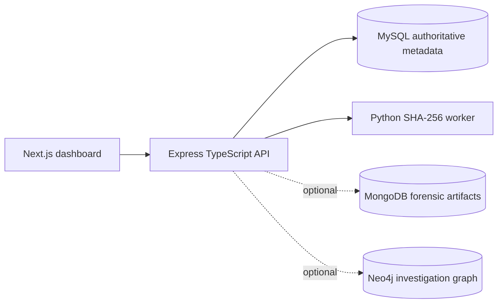

# Digital Evidence Chain Management System

An incremental college DBMS project for recording investigations, evidence registration, custody, forensic analysis, integrity verification, and audit history.

## Architecture



MySQL remains the source of truth for users, cases, evidence, custody, analysis, integrity alerts, and audit records. Files are stored under the configured evidence root with generated names. The original SHA-256 is immutable in the evidence row. MongoDB and Neo4j are optional integrations and report `503` when not configured or unavailable; their writes are intentionally not claimed to be atomic with MySQL.

## Run on Windows PowerShell

1. Copy `backend/.env.example` to `backend/.env` and fill in local values. Never commit `.env`.
2. Apply the existing database bootstrap, then run `database/mysql/001_advanced_features.sql` once.
3. Start the API: `cd backend; npm install; npm run dev`.
4. From the repository root, start the dashboard: `cd ..\frontend; npm install; npm run dev`.
5. From the repository root, run the Python tests: `cd ..\forensic-service; python -m unittest discover -s . -p 'test_*.py'`.

For a local demonstration with dummy accounts, run `cd backend; npm run seed-demo` after the MySQL schema and migrations are ready. The command is idempotent and creates no real evidence: it adds two synthetic cases, two small text evidence files, two custodians, an investigator, an analyst, an administrator, custody history, analysis records, an open integrity alert, and audit entries. It never deletes or overwrites existing records. The command prints the demo passwords; do not use these accounts outside local development.

If you are currently inside `backend`, use `cd ..\forensic-service` for the Python service—not `cd forensic-service`.

## Cloud deployment configuration

The frontend environment is evaluated when Next.js is built. For a separate cloud frontend and backend, set `NEXT_PUBLIC_API_URL` in the frontend deployment to the backend's public HTTPS URL, such as `https://api.example.com` or `https://api.example.com/api`, then redeploy the frontend. The client normalizes either form to the `/api` base. Set `FRONTEND_ORIGIN` in the backend deployment to the exact frontend origin, such as `https://app.example.com`, and restart the backend. Do not use `localhost` in cloud environment variables. If both services are served behind the same domain and `/api` is reverse-proxied to Express, the frontend can use its same-origin `/api` fallback.

To create the first administrator without committing a password, set temporary PowerShell variables and run `npm run bootstrap-admin` from `backend`:

```powershell
$env:BOOTSTRAP_ADMIN_EMAIL = "admin@example.test"
$env:BOOTSTRAP_ADMIN_NAME = "System Administrator"
$env:BOOTSTRAP_ADMIN_PASSWORD = "choose-a-long-local-password"
npm run bootstrap-admin
Remove-Item Env:BOOTSTRAP_ADMIN_EMAIL,Env:BOOTSTRAP_ADMIN_NAME,Env:BOOTSTRAP_ADMIN_PASSWORD
```

The first administrator must be bootstrapped out-of-band with a bcrypt/Argon2 hash; no production password is hardcoded. The current API exposes administrator-only user creation at `POST /api/users` after login.

## Core API examples

```text
POST /api/auth/login                  {"email":"admin@example.test","password":"..."}
GET  /api/cases                       Authorization: Bearer <token>
POST /api/cases                       {"case_number":"DEC-2026-002","title":"Demo case"}
POST /api/evidence (multipart/form-data) case_id, evidence_name, evidence_type, evidence file
POST /api/evidence/:id/transfer       {"to_user_id":2,"reason":"Examination"}
POST /api/evidence/:id/verify         recalculates stored bytes and preserves the original hash
POST /api/analysis                    {"evidence_id":1,"analysis_type":"Timeline review"}
PATCH /api/cases/:id/status           {"status":"CLOSED"}
```

## MongoDB forensic artifacts

MongoDB is optional for the core MySQL workflow. Configure `MONGO_URI` and `MONGO_DB` in the ignored `backend/.env`; the API returns a safe `503` status when MongoDB is unavailable. Artifact routes are authenticated: `GET /api/integrations/artifacts?evidence_id=1&page=1&page_size=25`, `GET /api/integrations/artifacts/:artifact_id`, and `POST /api/integrations/artifacts` for `ANALYST` or `ADMIN` users.

Neo4j preparation uses exactly `NEO4J_URI`, `NEO4J_USER`, `NEO4J_PASSWORD`, and optional `NEO4J_DATABASE` (default `neo4j`). After configuring them in the ignored `backend/.env`, an authenticated read-only check is available at `GET /api/integrations/neo4j-health`. It returns `200` only after `RETURN 1 AS ok` succeeds against the configured database; missing configuration, connection failures, and authentication/query failures return safe `503` responses. Graph synchronization is not enabled by this check.

Artifact documents contain `artifact_id`, `evidence_id`, `evidence_code`, `artifact_type`, `source_filename`, JSON `fields`, `parser.name`, `parser.version`, `observed_at`, `extraction_status`, a safe `error` when extraction fails, `provenance.source` (which must be `forensic-service`), `provenance.method`, `provenance.input_sha256`, `created_by`, `created_at`, and an `idempotency_key`. Supported types are `IMAGE_METADATA`, `VIDEO_METADATA`, `AUDIO_METADATA`, `DOCUMENT_METADATA`, `EXTRACTED_METADATA`, `PARSER_FINDING`, and `OBSERVATION`. Payloads reject credential-like fields, unsafe filenames, invalid hashes, unsupported types, malformed timestamps, failed records without errors, completed records with errors, and fields over 256 KB. The API verifies that the evidence exists in MySQL and that the provenance hash matches its immutable original SHA-256. MongoDB creates indexes for evidence/time lookup, type/status filters, and unique idempotency keys.

The current Python service only performs streaming SHA-256 hashing. It is not an extractor, so the dashboard artifact form is for validated extraction output and does not claim that a parser ran. A future extractor should submit only genuine output using the same provenance contract.

## DBMS concepts demonstrated

The migration adds `v_case_summary`, `v_custody_history`, immutable audit triggers, indexes, `sp_transfer_custody`, and `sp_close_case`. Custody uses `SELECT ... FOR UPDATE`; the API also locks the evidence row and rejects stale custodians. Case closure requires no pending/in-progress analysis and no unresolved integrity alerts.

Evidence registration supports PDF, DOC, DOCX, TXT, JPG/JPEG, PNG, TIFF, BMP, MP4, MOV, AVI, MKV, MP3, WAV, E01, raw disk-image extensions (`.dd`, `.img`, `.raw`, `.dmg`), and text artifacts such as LOG, CSV, JSON, and XML. The server checks file signatures for formats with recognizable magic bytes; raw disk images have no universal magic and therefore use an explicit extension plus the configured size limit. `MAX_UPLOAD_BYTES` defaults to 512 MiB and can be lowered or raised in `backend/.env`. Files are streamed by the Python hashing worker and are never decoded, re-encoded, or executed.

## Verification performed

- `backend`: `npm run build` passes.
- `forensic-service`: 2 Python unit tests pass, including a known SHA-256 vector and path escape rejection.
- `frontend`: `npm run build` passes when run with normal Windows process permissions.
- MySQL: migration applied successfully; both views, both procedures, and both audit triggers verified; `v_case_summary` queried successfully.
- MongoDB/Neo4j: integration code and parameterized queries are present, but availability depends on local services and credentials. The dashboard includes sign-in, overview metrics, case list/details/creation, evidence listing/registration, custody, alerts, analysis, and audit views.

## Limitations

Sessions are in-memory for this college demonstration and are lost when the API restarts; use a shared session store for production. Filesystem storage and MySQL cannot form one normal atomic transaction, so registration uses compensation cleanup on failure. A hash mismatch records a discrepancy and does not attribute misconduct.
